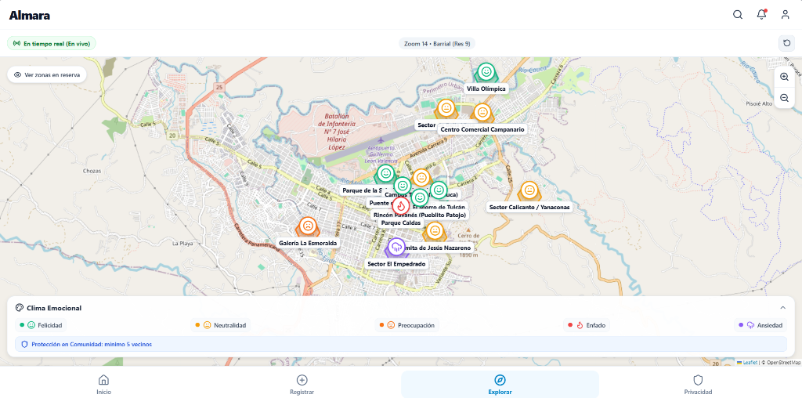

# Almara — Backend (`almara-backend`)

Núcleo de servicios y procesamiento de **Almara (Inteligencia Emocional Urbana)**, desarrollado con **Java 21 LTS** y **Spring Boot 3.3**.

La plataforma permite recolectar de forma completamente anónima las emociones de los ciudadanos, procesarlas mediante agregación territorial en tiempo real para la ciudad de Popayán y poner a disposición paneles analíticos para la toma de decisiones institucionales, garantizando en todo momento la privacidad de las personas mediante técnicas de protección comunitaria (k-anonimato).

---

## Paneles del Sistema por Rol

### 1. Panel de Administración
Permite configurar el catálogo oficial de emociones, calibrar los umbrales de privacidad comunitaria, gestionar las zonas urbanas y administrar las cuentas de entidades institucionales.


### 2. Panel de Cliente Institucional
Diseñado para alcaldías, universidades y empresas. Ofrece indicadores clave de clima emocional urbano, distribución porcentual de emociones en Popayán, filtros por sectores territoriales y exportación de reportes oficiales.


### 3. Aplicación y Explorador Ciudadano
Permite a cualquier ciudadano reportar su emoción en segundos (de forma anónima) y explorar el mapa colectivo de la ciudad en vivo con actualización en tiempo real.



---

## Requisitos Previos

Para ejecutar el backend de forma local se requiere:

- **Java 21 LTS** instalado y configurado en el `PATH`.
- **Apache Maven 3.9+** (o el wrapper `mvnw`).
- **Docker Desktop** (para levantar PostgreSQL con PostGIS y Redis).

---

## Guía de Configuración y Ejecución

### 1. Iniciar la infraestructura de datos (PostgreSQL y Redis)
Desde la raíz del proyecto, ejecute:

```bash
cd almara-infra
docker compose up -d
```

Esto iniciará:
- **PostgreSQL 16 + PostGIS 3.4** en el puerto `5432` (`almara_db`, usuario: `almara_user`, contraseña: `almara_secret_password`).
- **Redis 7** en el puerto `6379`.

### 2. Configurar variables de entorno o archivo de propiedades
El backend lee la configuración de [`src/main/resources/application.yml`](src/main/resources/application.yml). Puede ajustar las credenciales de conexión o definir variables de entorno si utiliza valores personalizados:

```env
SPRING_DATASOURCE_URL=jdbc:postgresql://localhost:5432/almara_db
SPRING_DATASOURCE_USERNAME=almara_user
SPRING_DATASOURCE_PASSWORD=almara_secret_password
REDIS_HOST=localhost
REDIS_PORT=6379
```

> **Nota sobre correo (SMTP):** El sistema incluye soporte para notificaciones por correo (activación de cuentas y comprobantes de suscripción). Si no se configuran credenciales SMTP reales, el sistema utiliza un simulador automático en consola para no interrumpir las pruebas locales.

### 3. Compilar y arrancar el backend
Desde la carpeta `almara-backend`:

```bash
# Ejecutar pruebas unitarias
mvn test

# Iniciar la aplicación
mvn spring-boot:run
```

Las migraciones de base de datos (Flyway) se aplican automáticamente al iniciar, creando las tablas e insertando los datos iniciales (catálogo de emociones con íconos vectoriales normalizados, zonas de Popayán, planes SaaS y usuario administrador predeterminado).

---

## URLs Principales del Backend

Una vez iniciado en `http://localhost:8080`:

| Servicio / Recurso | Método / Ruta | Descripción |
|---|---|---|
| **API Base** | `http://localhost:8080/api/v1` | Prefijo unificado para todos los servicios REST |
| **Ingesta de Emociones** | `POST /api/v1/emociones/seleccionar` | Registro anónimo ciudadano de emoción y zona |
| **Intensidad de Emoción** | `POST /api/v1/emociones/intensidad` | Registro opcional de nivel de intensidad (1 a 5) |
| **Comentario Ciudadano** | `POST /api/v1/emociones/comentario` | Registro de comentario cualitativo anónimo |
| **Catálogo de Emociones** | `GET /api/v1/emociones/catalogo` | Consulta de emociones activas, colores e íconos |
| **Mapa Territorial** | `GET /api/v1/geo/mapa` | Consulta de hexágonos y zonas con filtro de privacidad |
| **Canal en Tiempo Real** | `ws://localhost:8080/ws` | WebSocket / STOMP para suscripción a eventos en vivo |
| **Auth Institucional** | `/api/v1/institutional/auth/*` | Registro, validación de correo y login de entidades |
| **Dashboard Institucional** | `/api/v1/institutional/dashboard/*` | Resumen de ciudad, filtros territoriales y reportes |
| **Suscripciones y Planes** | `/api/v1/institutional/planes/*` | Catálogo de planes, checkout simulado y pagos |
| **Módulo Administrativo** | `/api/v1/admin/*` | Gobernanza del catálogo, umbrales y usuarios |

---

## Credenciales Iniciales de Prueba

El sistema inicializa automáticamente la cuenta del administrador principal:

- **Usuario:** `admin@almara.com`
- **Contraseña:** `AdminAlmara2026!`
- **Rol:** `ROLE_ADMIN`
