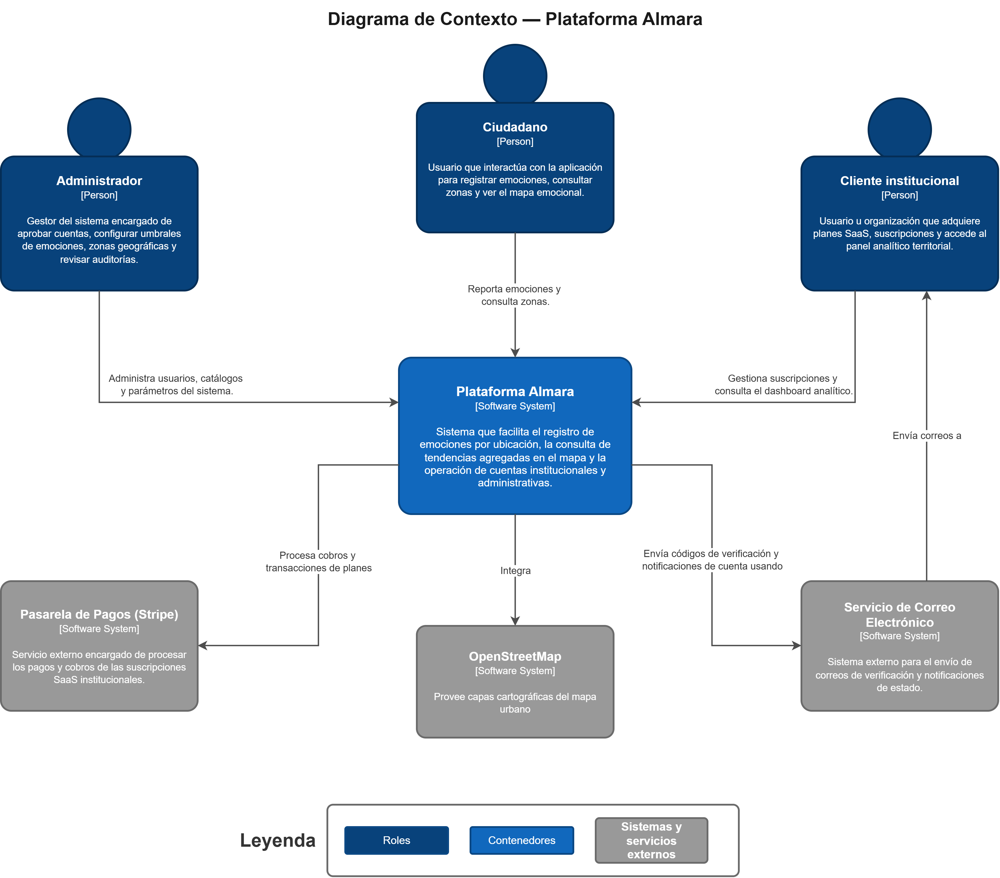
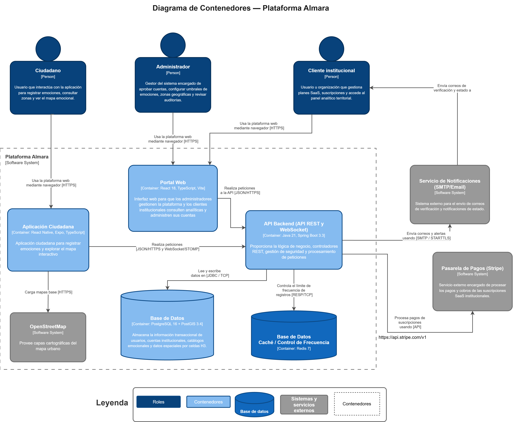
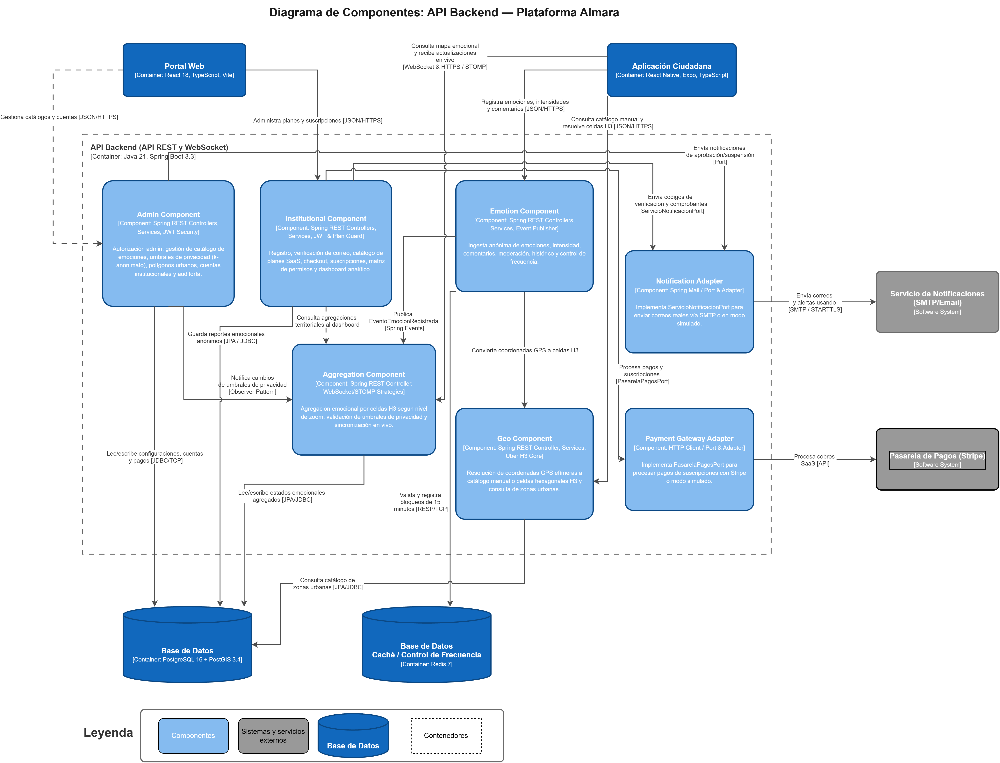
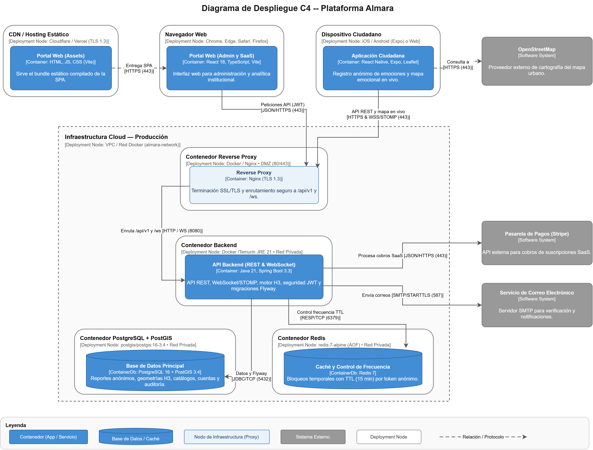

# 2. Modelo C4 — Arquitectura de Software de Almara

Este documento presenta la arquitectura de **Almara** siguiendo los cuatro niveles del **Modelo C4** (Contexto, Contenedores, Componentes y Despliegue), acompañados de sus diagramas en formato `.png` y su descripción contextual.

---

## Nivel 1: Diagrama de Contexto del Sistema (C1)

El diagrama de contexto muestra a **Almara** como una caja negra interactuando con sus tres tipos de usuarios humanos y los sistemas externos necesarios para su operación:

- **Ciudadano:** Registra su estado emocional de forma 100% anónima (emoción, intensidad, comentario opcional y ubicación) y explora el mapa emocional colectivo en tiempo real.
- **Cliente Institucional (SaaS):** Alcaldías, universidades u organizaciones que consultan indicadores agregados, filtros territoriales, reportes descargables y gestionan sus planes de suscripción.
- **Administrador:** Gobierna el catálogo de emociones, calibra el umbral de privacidad ($k$-anonimato), supervisa zonas urbanas y aprueba/gestiona cuentas institucionales.
- **Sistemas Externos:** Pasarela de pagos (**Stripe**), servicio de correo (**SMTP**) para verificación y comprobantes, y proveedor de mapas (**OpenStreetMap / Leaflet**).

---

## Nivel 2: Diagrama de Contenedores (C2)

El diagrama de contenedores desglosa el límite del sistema en sus unidades ejecutables y almacenes de datos:

1. **Aplicación Ciudadana (`almara-frontend/app`):** Desarrollada en **React Native + Expo**, ejecutable en móvil y navegador web (`localhost:8081`). Consume la API REST y se suscribe a actualizaciones en vivo por WebSocket.
2. **Portal Web Administrativo e Institucional (`almara-frontend/web`):** SPA desarrollada en **React + TypeScript + Vite + Tailwind CSS** (`localhost:5173`). Provee los paneles de gobernanza y analítica SaaS protegidos con JWT y RBAC.
3. **API Backend Modular (`almara-backend`):** Aplicación **Java 21 + Spring Boot 3.3** (`localhost:8080`) que concentra la lógica de negocio, motor de agregación espacial H3, autenticación JWT y servidor WebSocket.
4. **Base de Datos Espacial (`PostgreSQL + PostGIS`):** Almacena zonas urbanas, polígonos geográficos, reportes emocionales anónimos, catálogo de emociones, cuentas institucionales, planes y órdenes de pago.
5. **Almacenamiento en Memoria (`Redis`):** Soporta *rate limiting* anti-spam por sesión anónima y caché de proyecciones agregadas del mapa.

---

## Nivel 3: Diagrama de Componentes (C3)

El nivel de componentes detalla la organización interna del contenedor **API Backend (`almara-backend`)**, estructurado en cinco módulos de dominio desacoplados bajo el patrón MVC:

- **`emotion`:** Ingesta anónima de emociones, validación de intensidad, comentarios y control anti-spam.
- **`geo`:** Resolución espacial mediante GPS o catálogo manual hacia celdas hexagonales H3 y zonas de Popayán.
- **`aggregation`:** Motor de agregación por ventana temporal, aplicación de $k$-anonimato y difusión en tiempo real vía WebSocket.
- **`admin`:** Gobernanza del catálogo de emociones, configuración de umbrales de privacidad y ciclo de vida de entidades institucionales.
- **`institutional`:** Registro con verificación de correo, analítica territorial, exportación de reportes y flujo de suscripciones/pagos SaaS (Stripe).

> El desglose detallado de cada uno de los cinco módulos se encuentra en el documento **[3. Diagrama de Componentes](03-diagrama-de-componentes.md)**.

---

## Nivel 4: Diagrama de Despliegue (C4)

El diagrama de despliegue ilustra cómo se distribuyen los contenedores de software sobre la infraestructura de ejecución (entorno contenerizado con Docker Compose para servicios de datos y nodos de aplicación para backend y frontends), garantizando comunicación cifrada, aislamiento de red para PostgreSQL/PostGIS y Redis, y acceso controlado a servicios externos (Stripe y SMTP).

