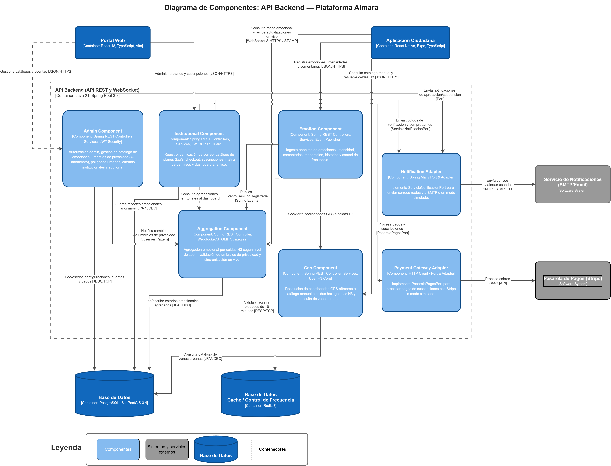
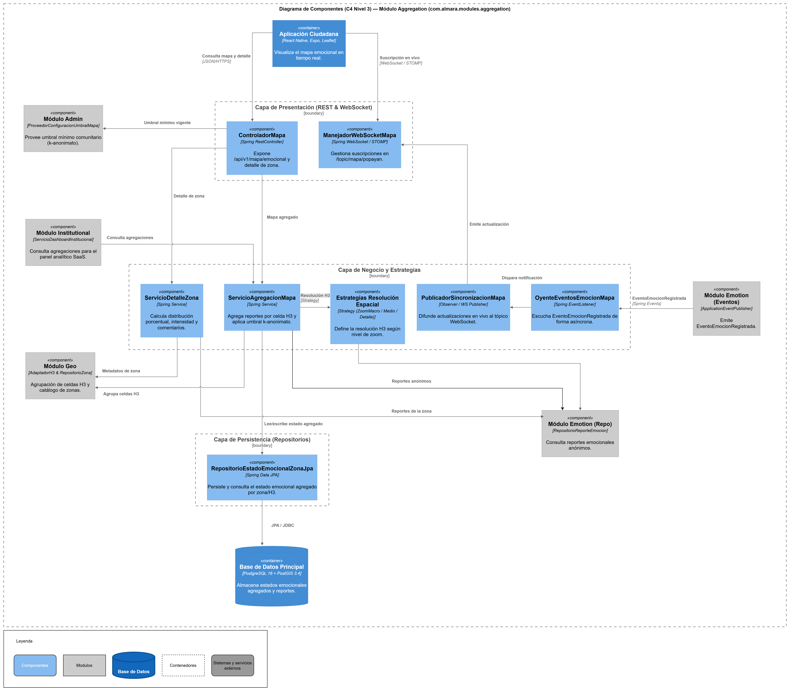
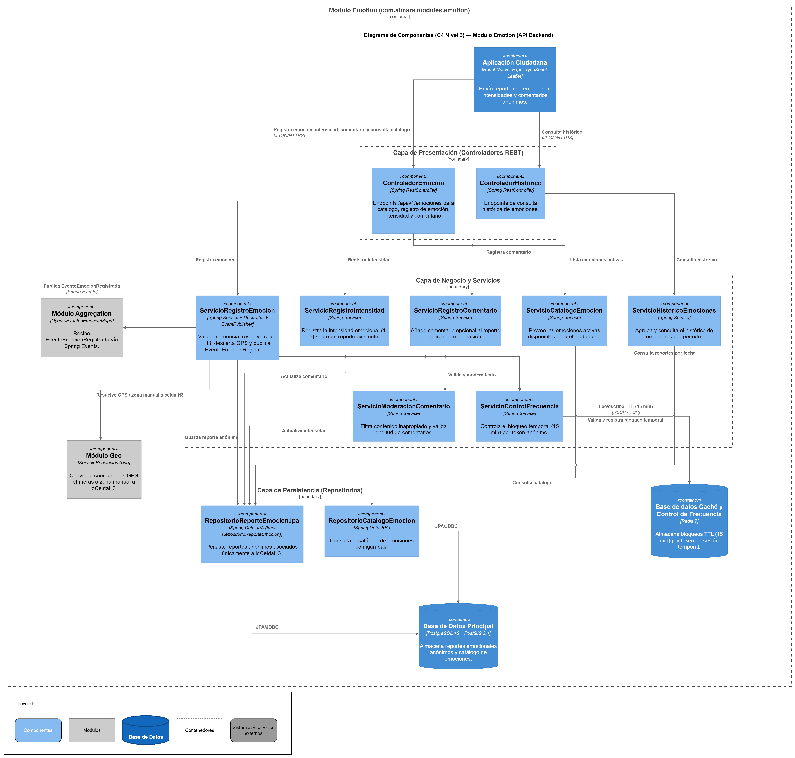
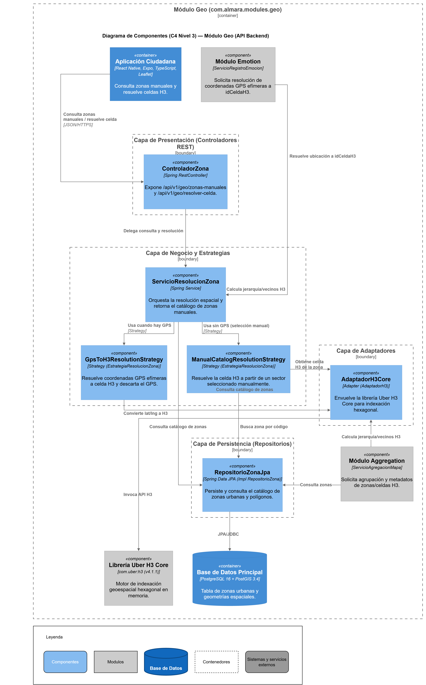

# 3. Diagrama de Componentes — Proyecto Almara

Este documento presenta la vista de componentes del sistema **Almara**, abarcando tanto la vista general de integración entre capas como el desglose interno de los cinco módulos del backend (`almara-backend`).

---

## 3.1 Vista General de Componentes del Backend

La arquitectura interna del backend sigue una separación estricta por módulos de dominio y capas MVC (`Controller` → `Service` → `Repository` / `Port-Adapter`), garantizando trazabilidad directa entre los diagramas y el código fuente en `almara-backend/src/main/java/com/almara/modules/`.

---

## 3.2 Desglose de Componentes por Módulo Funcional

### 1. Módulo `admin` (Gobernanza y Administración)
- **Responsabilidades:** Autenticación administrativa, gestión del catálogo de emociones (con íconos normalizados), calibración del umbral de $k$-anonimato y gestión del ciclo de vida de cuentas institucionales.
- **Patrones clave:** *State*, *Factory*, *Observer* (notificación de cambio de umbral a la caché del mapa) y *Adapter* (PostGIS/H3).

---

### 2. Módulo `aggregation` (Agregación Espacial y Tiempo Real)
- **Responsabilidades:** Cálculo de distribuciones emocionales por celda H3 y ventana temporal, protección de privacidad mediante reserva cuando $n < k$, selección de resolución por zoom y transmisión en vivo por WebSocket.
- **Patrones clave:** *Strategy* (estrategias de zoom Macro/Medio/Detalle), *Publish-Subscribe / Observer* (WebSocket) y *Cache-Aside*.

---

### 3. Módulo `emotion` (Ingesta Anónima de Emociones)
- **Responsabilidades:** Recepción de reportes ciudadanos (emoción, intensidad y comentario opcional), validación contra catálogo activo, control de *cooldown* / *rate limiting* anónimo y publicación del evento para agregación.
- **Patrones clave:** *DTO*, *Repository* y *Publish-Subscribe*.

---

### 4. Módulo `geo` (Resolución Geoespacial)
- **Responsabilidades:** Conversión de coordenadas GPS a índices hexagonales H3 y resolución alternativa mediante catálogo manual de sectores/zonas urbanas de Popayán.
- **Patrones clave:** *Strategy* (`GpsToH3ResolutionStrategy`, `ManualCatalogResolutionStrategy`) y *Repository*.

---

### 5. Módulo `institutional` (Analítica SaaS, Suscripciones y Pagos)
- **Responsabilidades:** Registro y verificación de entidades institucionales, dashboard analítico territorial, exportación de reportes oficiales, gestión de carrito/órdenes de suscripción SaaS e integración con pasarela de pagos y notificaciones.
- **Patrones clave:** *Ports & Adapters* (`PasarelaPagoPort`, `ServicioNotificacionPort`), *Adapter* (`AdaptadorStripePasarelaPago`, `AdaptadorPasarelaPagoSimulada`, `AdaptadorNotificacionSmtp`), *DTO* y *Repository*.

