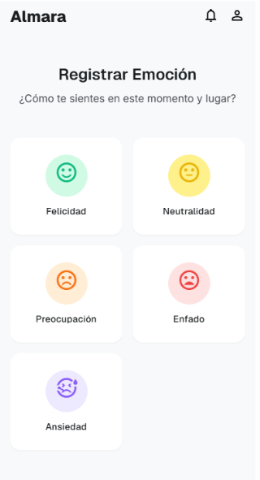
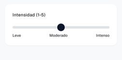
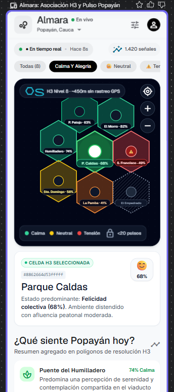
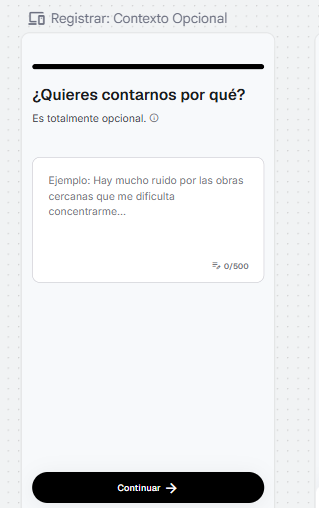
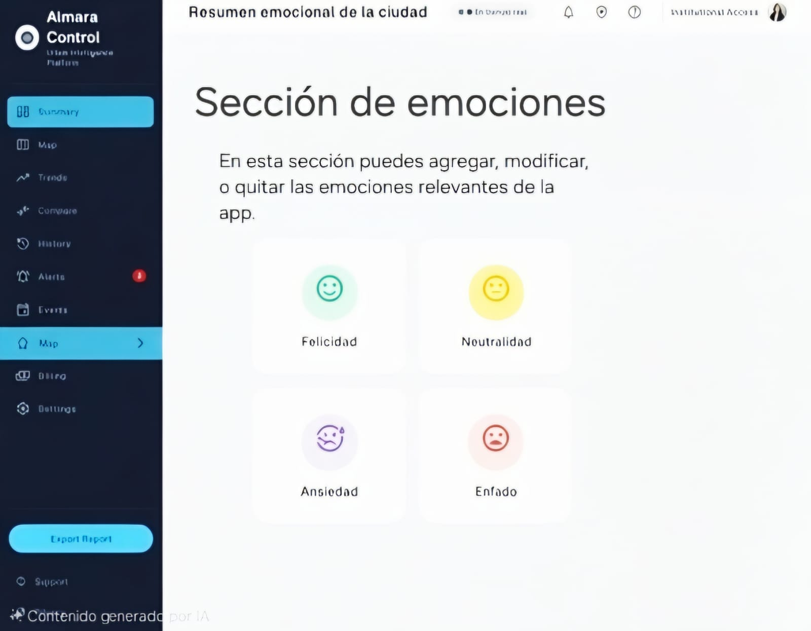
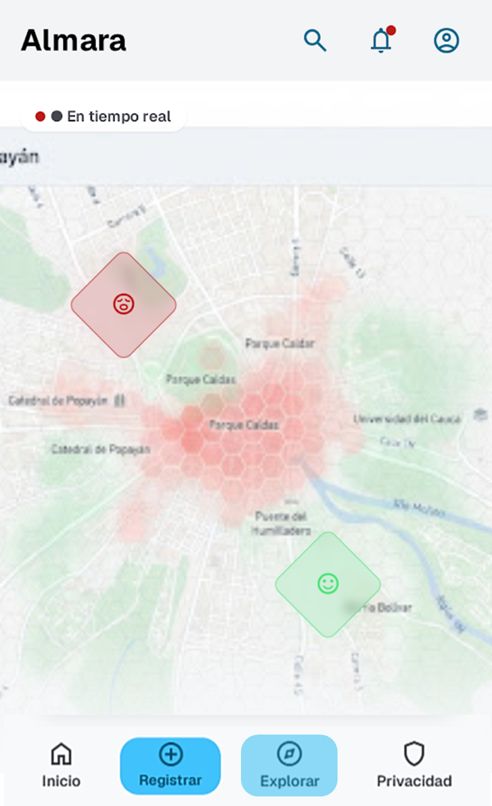

# 4. Historias de Usuario — Proyecto Almara

> Documento unificado y generado a partir de Historias_de_Usuario Entrega corte 2.xlsx (HU-01 a HU-24).

## Tabla de Contenidos

- [HU-01 SV](#hu-01-sv)
- [HU-02 FD](#hu-02-fd)
- [HU-03 VP](#hu-03-vp)
- [HU-04 SV](#hu-04-sv)
- [HU-05 FD](#hu-05-fd)
- [HU-06 VP](#hu-06-vp)
- [HU-07 SV](#hu-07-sv)
- [HU-11 SV](#hu-11-sv)
- [HU-12 FD](#hu-12-fd)
- [HU-13 FD](#hu-13-fd)
- [HU-14 SV](#hu-14-sv)
- [HU-15 FD](#hu-15-fd)
- [HU-16 VP](#hu-16-vp)
- [HU-17 VP](#hu-17-vp)
- [HU-18 VP](#hu-18-vp)
- [HU-19](#hu-19)
- [HU-20](#hu-20)
- [HU-21](#hu-21)
- [HU-22](#hu-22)
- [HU-23](#hu-23)
- [HU-24](#hu-24)

---

## HU-01 SV

- **Historia de Usuario:** HU-01 - Seleccionar emoción
- **Estudiante Responsable:** Eyder Santiago Vivas Sánchez
- **Prioridad:** Alta
- **Título:** Permitir a una persona escoger su emoción actual de un lugar o de una calle en particular.
- **Como:** Persona que usa la aplicación Almara
- **Quiero:** Escoger mi emoción actual de una lista predefinida
- **Para:** Generar una visualización mapeada con un color determinado según la emoción ingresada y contribuir al estado de ánimo colectivo de la ciudad
- **Validaciones (Criterios de Aceptación):** 1. La emoción escogida no debe ser cambiada en un lapso de tiempo determinado.  
  2. La emoción se elige entre algunas opciones predeterminadas.  
  3. Se mantiene el anonimato de la persona (no se requiere ni almacena información personal que permita identificar individuos).  
  4. Se registra automáticamente la fecha y hora del envío.  
  5. Se muestra un mensaje de confirmación al usuario tras el envío exitoso.
- **Requerimientos No Funcionales (RNF - ISO/IEC 25010):** Seguridad: no se persiste información personal del usuario, la sesión se gestiona con identificadores aleatorios no rastreables.   
    
  Eficiencia de Desempeño: El tiempo de confirmación de registro y publicación del evento debe ser inferior a 1000 ms bajo condiciones normales.  
    
  Adecuación Funcional: (Rate Limiting) Validación de unicidad por dispositivo para evitar envíos redundantes.
- **Atributos de Calidad:** • Seguridad: no se captura ni almacena dato personal identificable, la comunicación viaja cifrada (HTTPS/TLS).  
  • Rendimiento: el evento debe publicarse al bus de eventos en menos de 1 segundo, dado el volumen esperado de miles de envíos concurrentes.  
  • Disponibilidad: el servicio de ingreso de emociones es el punto de entrada principal del sistema, por lo que requiere alta disponibilidad y tolerancia a fallos.  
  • Usabilidad: selección de la emoción en máximo dos toques, con iconografía clara y comprensible.  
  • Unicidad: control de duplicidad de envíos dentro del lapso de bloqueo definido para un mismo dispositivo o sesión.
- **Patrones de Diseño:** DTO (Data Transfer Object): Garantiza que solo los campos estrictamente requeridos ingresen al sistemas, descartando cualquier payload malicioso o datos de identidad.  
    
  Publicador/Suscriptor: Al recibir la emoción, la API publica el evento en un intermediario liviano para responder inmediatamente en menos de 1 segundo, desacoplando el cálculo del mapa de calor colectivo.
- **Limitaciones del Alcance:** La entrada es manual y restringida a unas pocas emociones. No procesa eventos complejos como imágenes, audio, etc.  
    
  Al tratar de ser anónimo, podría evadirse el sistema anti spam y enviarse varias emociones por usuario.  
    
  Esta historia de usuario solo contempla la elección y guardado temporal de la emoción pero no su procesamiento y visibilidad en el mapa.
- **Consideraciones y Notas:** • Variables requeridas:   
  • emoción_seleccionada (enum/varchar(20), catálogo cerrado: alegría, tristeza, enojo, miedo, calma, sorpresa).  
  • token_sesión_temporal (varchar(64), identificador anónimo no persistente).  
  • fecha_hora_envío (datetime, generado automáticamente por el servidor).  
  • Opcionales: no aplica
**Diseño UI / Mockup**

---

## HU-02 FD

- **Historia de Usuario:** HU-02 - Indicar intensidad de la emoción
- **Estudiante Responsable:** Freddy David Maca Urbano
- **Prioridad:** Alta
- **Título:** Permitir a una persona indicar la intensidad de su emoción actual de un lugar o de una calle en particular.
- **Como:** Persona que ingresó a la aplicación Almara y que ya escogió su emoción actual
- **Quiero:** Escoger la intensidad de mi emoción de unos valores ya establecidos
- **Para:** Generar una visualización colorida según la intensidad de la emoción escogida para contribuir a la comunidad Almara.
- **Validaciones (Criterios de Aceptación):** 1. Si no se ha seleccionado la emoción, no se habilita la opción de la intensidad.  
  2. Se mantiene el anonimato de la persona (no se requiere ni almacena información personal identificable).  
  3. Se registra automáticamente la fecha y hora del envío.  
  4. Se muestra un mensaje de confirmación al usuario tras el envío exitoso.
- **Requerimientos No Funcionales (RNF - ISO/IEC 25010):** Usabilidad: El componente interactivo de selección de intensidad debe estar inhabilitado (disabled) por defecto y habilitarse en menos de 100 ms tras recibir la selección válida de una emoción.                                                                                                                                                                                 Desempeño: La validación en backend y persistencia del nivel de intensidad asignado debe procesarse dentro de un tiempo de respuesta de API inferior a 300 ms.                                                                                                                                                                                                                                Seguridad: se mantienen las mismas condiciones de anonimato y cifrado en tránsito que en HU-01.
- **Atributos de Calidad:** • Integridad: la intensidad debe quedar correctamente asociada al mismo evento de emoción, sin desincronización entre pasos.  
  • Usabilidad: el control de intensidad permanece deshabilitado en la interfaz mientras no exista una emoción previa, validado también en frontend.  
  • Rendimiento: el procesamiento debe completarse dentro de la misma ventana de interacción, sin latencia perceptible para el usuario.
- **Patrones de Diseño:** Data Transfer Object (Arquitectónico): Encapsula exclusivamente los atributos estrictamente necesarios
- **Limitaciones del Alcance:** Inmutabilidad del envío: No contempla la modificación, corrección ni eliminación del nivel de intensidad una vez que la transacción ha sido confirmada y enviada. Escala cerrada y fija: La selección se limita estrictamente a los valores previamente estipulados en la aplicación, no hay entrada manua de valores.
- **Consideraciones y Notas:** • Requeridas: id_evento_emoción (referencia al evento generado en HU-01, para asociar correctamente la intensidad).  
  • Requeridas: nivel_intensidad (entero pequeño o enum, ej. 1 a 5, o bajo/medio/alto).  
  • Opcionales: no aplica.
**Diseño UI / Mockup**

---

## HU-03 VP

- **Historia de Usuario:** HU-03 - Ingresar comentario complementario a la emoción
- **Estudiante Responsable:** Valentina Paz Manquillo
- **Prioridad:** Baja
- **Título:** Permitir a una persona ingresar un comentario opcional sobre su emoción actual en un lugar o calle en particular.
- **Como:** Persona que usa la aplicación Almara
- **Quiero:** Registrar un comentario breve en un campo de texto junto
- **Para:** Reforzar mi emoción escogida
- **Validaciones (Criterios de Aceptación):** 1. El comentario ingresado no debe superar la longitud máxima permitida de 200 caracteres.  
  2. El campo de texto no debe permitir el ingreso de números o caracteres no válidos. 3.El comentario debe ser completamente opcional; si el usuario no diligencia texto, el registro de la emoción se procesa normalmente omitiendo el campo de texto.
- **Requerimientos No Funcionales (RNF - ISO/IEC 25010):** Seguridad: Limpieza de datos y codificación estricta del campo libre en el Frontend y Backend para mitigar ataques XSS (Cross-Site Scripting) e inyección de datos.  
  Usabilidad: Inclusión de un contador interactivo de caracteres restantes (200/200) y retroalimentación visual inmediata ante caracteres prohibidos.                            Eficiencia de Desempeño: El proceso de validación,limpieza de datos y moderación de contenido del texto debe mantener la agilidad y fluidez en el registro.
- **Atributos de Calidad (referencia del documento original):** • Seguridad: sanitización estricta del campo de texto libre para prevenir inyecciones (XSS/SQL injection), dado que el contenido se expone públicamente en el mapa.  
  • Moderación de contenido: se recomienda un filtro de palabras ofensivas o inapropiadas previo a la publicación del comentario.  
  • Usabilidad: contador de caracteres visible y validación en tiempo real de caracteres no permitidos.  
  • Rendimiento: el filtrado o moderación automática no debe añadir latencia perceptible al flujo de envío del comentario.
- **Patrones de Diseño:** Patrón Decorator (Estructural): Se aplica sobre el objeto base del evento de emoción (EmotionEvent). Si el usuario decide escribir un comentario, se decora dinámicamente el evento agregando el atributo commentContext sin modificar la estructura original ni romper los contratos con los microservicios que solo leen la emoción/zona.
- **Limitaciones del Alcance:** No permite adjuntar elementos multimedia como fotos, notas de voz o videos al comentario.   
  No incluye funcionalidad de respuesta, hilo de conversación o interacción "Me gusta" entre usuarios sobre el comentario (mantiene el anonimato y flujo unidireccional).  
  No realiza traducción automática de idioma en los comentarios.
- **Consideraciones y Notas:** Requeridas (solo si el usuario decide comentar): texto_comentario (varchar(200)).  
  • Opcionales: el comentario en su totalidad es opcional dentro del flujo; si no se diligencia, el evento de emoción se registra sin este campo.
**Diseño UI / Mockup**

---

## HU-04 SV

- **Historia de Usuario:** HU-04 - Asociar emoción a una celda H3
- **Estudiante Responsable:** Eyder Santiago Vivas Sánchez
- **Prioridad:** Alta
- **Título:** Asociar automáticamente una emoción a una zona geográfica mediante celdas H3.
- **Como:** Persona que usa la aplicación Almara
- **Quiero:** Que mi emoción sea asociada automáticamente a mi zona o celda geográfica
- **Para:** Contribuir al estado emocional del lugar donde me encuentro sin revelar mi ubicación exacta
- **Validaciones (Criterios de Aceptación):** 1. La aplicación solicita permiso explícito de ubicación al usuario.  
  2. Al aceptar, las coordenadas precisas se transforman internamente a una celda geográfica H3.  
  3. Las coordenadas exactas/precisas no se guardan ni se exponen en las interfaces de consulta.  
  4. Si no se concede el permiso, se impide el envío o se permite seleccionar la zona manualmente.
- **Requerimientos No Funcionales (RNF - ISO/IEC 25010):** Seguridad: Las coordenadas exactas (latitud, longitud) únicamente deben residir en memomira durante la ejecución de la función de conversión H3. No deben persistirse en base de datos ni registrarse en logs del servidor.  
    
  Adecuación Funcional: La celda H3 resultante debe corresponder exactamente a la resolución prefijada para el sistema urbano (Resolución 8 o 9, que cubre áreas hexagonales de aprox. ~100 a ~450 metros de radio), garantizando anonimato sin perder representatividad barrial o comunal.  
    
  Usabilidad (Usability - Protección contra errores y Accesibilidad):  
    
  Si el usuario rechaza los permisos de geolocalización, la interfaz debe desplegar un selector manual intuitivo (por ejemplo, lista desplegable o buscador de barrios/zonas predefinidas), informando con claridad por qué se requiere la ubicación general.
- **Atributos de Calidad (referencia del documento original):** • Privacidad/Seguridad: las coordenadas exactas se descartan inmediatamente después de calcular la celda H3; no deben persistir en base de datos ni en registros de log.  
  • Precisión: la resolución de celda H3 debe equilibrar utilidad para análisis posteriores con anonimato, evitando zonas con muy poca densidad poblacional que permitan identificar a una persona.  
  • Disponibilidad: si el servicio de geolocalización falla, debe existir una alternativa de selección manual de zona sin bloquear el envío.  
  • Rendimiento: la conversión de coordenadas a celda H3 debe ejecutarse en menos de un segundo.
- **Patrones de Diseño:** Strategy: Permite definir dos estrategias intercambiables para resolver la zona geográfica: GpsToH3ResolutionStrategy (resolución automática a partir de coordenadas temporales) y ManualCatalogResolutionStrategy (asociación directa mediante el catálogo predefinido de zonas).  
    
  Adapter: Para desacoplar el consumo de la librería H3 Core del resto de la arquitectura.
- **Limitaciones del Alcance:** Exclusivamente captura puntual: no realiza rastreo en segundo plano ni guarda historiales de movimiento.  
    
  Resolución H3 estática prefijada para todo el entorno urbano.  
    
  Selección manual sujeta a un catálogo cerrado de zonas. No incluye geocodificación de direcciones escritas ni renderizado del polígono en pantalla.
- **Consideraciones y Notas:** • Requeridas: coordenadas_gps (latitud, longitud) decimal, capturadas de forma temporal únicamente para el cálculo de la celda, nunca persistidas.  
  • Requeridas: celda_h3_id (varchar(15), identificador resultante de la conversión a la resolución H3 definida para el proyecto).  
  • Opcionales: zona_manual_id (referencia a catálogo de zonas predefinidas, usada únicamente cuando el usuario no concede el permiso de ubicación).
**Diseño UI / Mockup**

---

## HU-05 FD

- **Historia de Usuario:** HU-05 - Consultar zonas de alta emoción
- **Estudiante Responsable:** Freddy David Maca Urbano
- **Prioridad:** Alta
- **Título:** Consultar el estado de ánimo de determinadas zonas en un mapa interactivo.
- **Como:** Persona que usa la aplicación Almara
- **Quiero:** Visualizar el estado de ánimo de las diferentes zonas de la ciudad en un mapa con la representación visual/color de la emoción predominante
- **Para:** Conocer el ambiente general y el clima colectivo de un lugar antes de desplazarme a él
- **Validaciones (Criterios de Aceptación):** 1. Se permite desplazar el mapa y realizar zoom libremente.  
  2. Únicamente se muestran las zonas o celdas que cumplen con el umbral mínimo de participación asignado.  
  3. Las zonas sin datos suficientes permanecen ocultas. Después de determinada cantidad de emociones se muestra la zona.  
  4. No se despliega información de usuarios individuales en el mapa.
- **Requerimientos No Funcionales (RNF - ISO/IEC 25010):** Desempeño: La consulta de celdas visibles y el renderizado gráfico de la capa emocional en el mapa interactivo debe responder en menos de 2.0 segundos. Usabilidad: Navegación fluida con gestos de desplazamiento (pan) y zoom, acompañada de una leyenda de convenciones visuales (paleta de colores por emoción) clara, accesible e intuitiva.                                                                                                                                                          Seguridad: Cualquier celda geográfica que no alcance el umbral mínimo de participación debe ocultarse por completo en el mapa para prevenir ataques de inferencia o reidentificación de personas.
- **Atributos de Calidad:** • Privacidad: aplicación de un principio de anonimato por agregación (k-anonimato), ocultando toda celda por debajo del umbral mínimo.  
  • Rendimiento: la consulta y el renderizado deben soportar múltiples celdas simultáneas con tiempos de respuesta bajos (idealmente menores a 2 segundos) dado el alto volumen de eventos.  
  • Escalabilidad: el servicio de agregación geográfica debe poder escalar horizontalmente ante picos de consulta concurrente de muchos usuarios.  
  • Usabilidad: interacción fluida de desplazamiento y zoom, con una leyenda de colores por emoción clara e intuitiva.
- **Patrones de Diseño:** Strategy Pattern (Comportamiento): Permite cambiar dinámicamente el algoritmo de resolución espacial de las celdas H3 según el nivel de zoom seleccionado por el usuario en el mapa
- **Limitaciones del Alcance:** Solo lectura: HU-05 abarca únicamente la consulta y visualización agregada del estado de ánimo colectivo; no permite el registro de nuevas emociones ni la interacción con formularios.                                                                                                                                                                                                Exclusión de zonas: Las celdas que no cumplan el umbral mínimo de participación no mostrarán datos parciales ni estimaciones; permanecerán sin capa emocional visible hasta alcanzar el volumen de registros requerido.                                                                                                                                         Sin desglose detallado: No incluye la lectura de comentarios, gráficos de tendencia por horas ni desglose de porcentajes por emoción dentro de la celda.
- **Consideraciones y Notas:** • Requeridas: área_visible_mapa (usada únicamente para la consulta de las celdas visibles, sin persistencia).  
  • Requeridas: umbral_mínimo_participación (entero configurable a nivel de plataforma, ej. mínimo de registros para mostrar una celda).  
  • Opcionales: nivel_zoom (usado para ajustar la resolución H3 mostrada en el mapa).
**Diseño UI / Mockup**

---

## HU-06 VP

- **Historia de Usuario:** HU-06 - Ver detalle zona de emoción
- **Estudiante Responsable:** Valentina Paz Manquillo
- **Prioridad:** Alta
- **Título:** Desplegar la distribución y tendencias emocionales de una celda seleccionada.
- **Como:** Persona que usa la aplicación Almara
- **Quiero:** Seleccionar una zona del mapa para ver en detalle de su distribución emocional
- **Para:** Entender de forma más detallada cómo se siente la comunidad en esa zona específica por medio de colores representativos y de los comentarios.
- **Validaciones (Criterios de Aceptación):** 1. Se despliega la emoción predominante, los porcentajes de las emociones principales y la tendencia actual.  
  2. Se especifica claramente el período temporal utilizado para la métrica.  
  3. El número exacto de participantes debe ocultarse o mostrarse de forma aproximada para resguardar la privacidad.
**Requerimientos No Funcionales (RNF - ISO/IEC 25010)**

- **Atributos de Calidad (referencia del documento original):** • Privacidad: el número de participantes se presenta de forma aproximada (ej. "más de 50 personas") y nunca como cifra exacta.  
  • Completitud: los porcentajes de emociones mostrados deben sumar el cien por ciento y reflejar la totalidad de registros del periodo consultado.  
  • Rendimiento: el cálculo agregado por celda debe estar precomputado o cacheado para responder de forma casi inmediata al seleccionar la zona.  
  • Usabilidad: el detalle de la celda debe alcanzarse en pocas interacciones desde el mapa principal.
**Patrones de Diseño**

**Limitaciones del Alcance**

- **Consideraciones y Notas:** • Requeridas: celda_h3_id_seleccionada (identificador de la celda sobre la que se solicita el detalle).  
  • Requeridas: periodo_temporal_métrica (rango de tiempo utilizado para calcular la distribución, ej. últimas 2 horas).  
  • Opcionales: no aplica.
**Diseño UI / Mockup**

---

## HU-07 SV

- **Historia de Usuario:** HU-07 - Sincronizar mapa
- **Estudiante Responsable:** Eyder Santiago Vivas Sánchez
- **Prioridad:** Alta
- **Título:** Sincronizar el mapa automáticamente ante cambios en el ánimo de la ciudad.
- **Como:** Persona que usa la aplicación Almara
- **Quiero:** Que el mapa se actualice de manera automática en tiempo real
- **Para:** Observar cambios en el ánimo colectivo de la ciudad sin necesidad de refrescar o recargar la pantalla
- **Validaciones (Criterios de Aceptación):** 1. Se establece una conexión en tiempo real (WebSocket).  
  2. El mapa refleja los cambios visuales dinámicamente sin recargar la página.  
  3. En caso de desconexión temporal, el sistema reintenta la reconexión de forma automática.  
  4. No se transmiten datos ni identificadores individuales durante las actualizaciones.
- **Requerimientos No Funcionales (RNF - ISO/IEC 25010):** Fiabilidad: Mecanismo de reconexión automática mediante retroceso exponencial. Conservación del último estado renderizado si el enlace se interrumpe.  
    
  Eficiencia de Desempeño: Latencia de propagación servidor-cliente inferior a 2 segundos. Soporte de concurrencia para pruebas de carga locales de al menos 50–100 clientes simultáneos.  
    
  Usabilidad: Transición fluida de color o estilo en las celdas ante actualizaciones dinámicas, reduciendo parpadeos molestos.
- **Atributos de Calidad (referencia del documento original):** • Disponibilidad: mecanismo de reconexión automática con reintentos progresivos ante caídas de conexión.  
  • Rendimiento: la propagación de un cambio agregado hacia los clientes conectados debe ocurrir en pocos segundos, dado el volumen de eventos esperado.  
  • Escalabilidad: la infraestructura de mensajería en tiempo real debe soportar miles de conexiones concurrentes sin degradar el servicio.  
  • Seguridad: por el canal solo se transmiten datos agregados, nunca identificadores ni datos de usuarios individuales.
- **Patrones de Diseño:** Publish-Subscribe: Para el envío eficiente de eventos a canales o tópicos específicos de visualización.  
    
  Observer: En el frontend, para actualizar las capas del mapa de forma desacoplada al recibir mensajes del socket.
- **Limitaciones del Alcance:** Canal de streaming estrictamente unidireccional (emisión servidor - cliente).  
    
  No garantiza entrega de eventos ocurridos durante caídas de conexión.  
    
  Visualización en tiempo real exclusivamente, no incluye histórico de estados pasados.
- **Consideraciones y Notas:** • Variables requeridas: canal_suscripción (identificador del canal de tiempo real WebSocket al que se suscribe el cliente).  
  • Variables opcionales: no aplica.
**Diseño UI / Mockup**

---

## HU-11 SV

- **Historia de Usuario:** HU-11 - Iniciar sesión en la app (Administrador)
- **Estudiante Responsable:** Eyder Santiago Vivas Sánchez
- **Prioridad:** Alta
- **Título:** Iniciar sesión como usuario administrador.
- **Como:** Administrador del sistema Almara
- **Quiero:** Iniciar sesión dentro del sistema con mis credenciales administrativas
- **Para:** Acceder al panel de configuración global y gestionar los parámetros de funcionamiento de la aplicación.
- **Validaciones (Criterios de Aceptación):** 1. El usuario y la contraseña son campos obligatorios.  
  2. El administrador debe tener una cuenta activa previamente en la base de datos.  
  3. La contraseña debe ser protegida mediante algoritmos de hashing seguro (BCrypt/Argon2).  
  4. Restringir el acceso y bloquear tras múltiples intentos fallidos.  
  5. Generar y retornar un token seguro de sesión (JWT) con claims de rol administrativo (ROLE_ADMIN).
- **Requerimientos No Funcionales (RNF - ISO/IEC 25010):** Seguridad : Contraseñas protegidas mediante criptografía (BCrypt/Argon2). Emisión de tokens de sesión JWT firmados criptográficamente para preservar la integridad de los claims administrativos.  
    
  Eficiencia de Desempeño: El ciclo de verificación y generación del token JWT debe completarse en menos de 500 ms.  
    
  Usabilidad: Cuando una persona ingrese datos incorrectos al iniciar sesión, el sistema debe mostrar un mensaje general que no permita identificar si el usuario existe o si la contraseña es incorrecta.
- **Atributos de Calidad (referencia del documento original):** • Seguridad: expiración controlada del token y almacenamiento seguro sin exponer la contraseña.  
  • Rendimiento: La autenticación y generación de credenciales no debe superar los 500 ms.  
  • Trazabilidad: Cada inicio de sesión administrativo debe quedar registrado en los logs de auditoría interna (RNF-13).
- **Patrones de Diseño:** Strategy Pattern: Permite manejar de forma organizada y flexible la manera en que el sistema protege y valida las contraseñas, facilitando cambiar este mecanismo en el futuro sin afectar otras partes de la aplicación.  
    
  Factory Method / Token Builder: Centraliza la creación de los tokens utilizados para mantener la sesión del usuario, asegurando que todos se generen de forma uniforme y siguiendo las mismas reglas.
- **Limitaciones del Alcance:** Las cuentas administrativas son preconfiguradas, no incluye el registro de admin en la aplicación.  
    
  No contempla flujo automatizado de recuperación de contraseña por correo electrónico.  
    
  No incluye autenticación de dos factores ni con proveedores externos (OAuth2).  
    
  Invalidación de sesión realizada únicamente por la expiración natural del token (sin servidor de revocación en tiempo real).
- **Consideraciones y Notas:** • Requeridas: usuario_admin (varchar(40), identificador único o correo del administrador).  
  • Requeridas: password_admin (varchar(255), contraseña ingresada en texto plano para validación).  
  • Opcionales: no aplica.
**Diseño UI / Mockup**

---

## HU-12 FD

- **Historia de Usuario:** HU-12 - Modificar catálogo de emociones predeterminadas
- **Estudiante Responsable:** Freddy David Maca Urbano
- **Prioridad:** Media
- **Título:** Modificar y gestionar las emociones predeterminadas de la plataforma.
- **Como:** Administrador del sistema Almara
- **Quiero:** Agregar, editar, desactivar o modificar las emociones del catálogo predeterminado y su configuración visual (color, ícono, etiqueta)
- **Para:** Adaptar las opciones emocionales disponibles para los ciudadanos según los requerimientos de análisis urbano
- **Validaciones (Criterios de Aceptación):** 1. Acción restringida exclusivamente a usuarios con rol ROLE_ADMIN.  
  2. No se permite eliminar físicamente emociones que ya cuenten con registros históricos asociados; únicamente se admite el borrado lógico (activo = false).  
  3. El formato de color debe cumplir con la estructura hexadecimal de 7 caracteres.  
  4. Debe mantenerse siempre un mínimo de 3 emociones activas en el catálogo para garantizar el funcionamiento del registro ciudadano (RF-05).
- **Requerimientos No Funcionales (RNF - ISO/IEC 25010):** Mantenibilidad: Las modificaciones en las propiedades del catálogo (colores, íconos, etiquetas) deben reflejarse de forma dinámica en los servicios consumidos por la aplicación sin requerir el reinicio del servidor ni un nuevo despliegue de software.                                                                                                                                                                                                                                                                                                                                                           Seguridad: La ejecución de operaciones está estrictamente restringida a usuarios con rol administrativo autenticado (ROLE_ADMIN), denegando cualquier acceso no autorizado con un código HTTP 403 Forbidden.                                                                                                                                                                               Usabilidad: Interfaz administrativa intuitiva con paleta de colores e iconografía accesible (RNF-21).
- **Atributos de Calidad:** • Integridad de datos: Las modificaciones de catálogo deben desplegarse correctamente a los servicios de frontend y backend sin corromper datos históricos pasados.  
  • Mantenibilidad: Ajuste centralizado y desacoplado del catálogo para no requerir nuevos despliegues de software al cambiar propiedades visuales (RNF-15).
- **Patrones de Diseño:** State Pattern (Comportamiento): Gestiona los estados del ciclo de vida de cada emoción dentro del catálogo (Activa vs Inactiva), habilitando o bloqueando automáticamente su disponibilidad en la interfaz de usuario según su estado.
- **Limitaciones del Alcance:** Inmutabilidad de identificadores: No se permite la alteración de la clave primaria (id_emocion) una vez creada, garantizando la integridad referencial con los eventos históricos.                                                                                                                                                                                                               Estructura plana del catálogo: La gestión se limita a una lista discreta de emociones; no contempla jerarquías complejas, subcategorías derivadas ni agrupaciones multinivel.
- **Consideraciones y Notas:** • Requeridas: id_emocion (varchar(20), clave única, ej. FELICIDAD, ENFADO).  
  • Requeridas: nombre_etiqueta (varchar(30), nombre visible para el usuario).  
  • Requeridas: codigo_hex_color (varchar(7), color asociado, ej. #FFCC00).  
  • Requeridas: icono_svg (varchar(255), recurso o referencia visual).  
  • Requeridas: activo (booleano true/false).  
  • Opcionales: descripcion (varchar(150), detalle contextual de la emoción).
**Diseño UI / Mockup**

---

## HU-13 FD

- **Historia de Usuario:** HU-13 - Ajustar umbrales para mostrar emociones en el mapa
- **Estudiante Responsable:** Freddy David Maca Urbano
- **Prioridad:** Alta
- **Título:** Ajustar umbrales mínimos de participación y reglas de privacidad para el mapa.
- **Como:** Administrador del sistema Almara
- **Quiero:** Configurar el parámetro del umbral mínimo de participación (k-anonimato) requerido para desplegar las emociones agregadas de una zona
- **Para:** Proteger la privacidad de los ciudadanos en áreas de baja afluencia y calibrar la sensibilidad del mapa dinámico
- **Validaciones (Criterios de Aceptación):** 1. Modificación permitida únicamente a administradores autenticados.  
  2. El valor del umbral mínimo k no puede ser inferior al límite técnico de seguridad de privacidad establecido (ej. k ≥ 5).  
  3. El cambio se aplica en caliente en el motor de agregación sin reiniciar el sistema.  
  4. Si una celda no alcanza el valor de k, el mapa debe ocultar automáticamente su capa emocional (RF-23).
- **Requerimientos No Funcionales (RNF - ISO/IEC 25010):** Seguridad (Control de Acceso): Restricción exclusiva de la funcionalidad a usuarios con rol administrativo (ROLE_ADMIN)                                                        Mantenibilidad: La actualización de parámetros globales de agregación debe ejecutarse en caliente, aplicando las nuevas reglas en el motor de consultas sin interrumpir el servicio ni requerir reinicios de la aplicación.
- **Atributos de Calidad:** • Privacidad: Garantía absoluta del principio de privacy by design mediante agregación protegida (RNF-08).                                                                                                                                                            • Desempeño: La propagación del nuevo umbral sobre la memoria cache debe completarse en menos de 500 ms
**Patrones de Diseño**

- **Limitaciones del Alcance:** Sin personalización por usuario final: El parámetro de privacidad es global para la plataforma, no contempla umbrales personalizados elegidos por los ciudadanos.          Sin procesamiento retroactivo: El ajuste afecta la renderización de celdas a partir de su modificación; no recalcula reportes o exportaciones analíticas que hayan sido generados previamente.                                                                                             Impacto visual puramente agregatorio: Modificar el umbral oculta o despliega la capa de color de las celdas H3 en el mapa público, pero no borra ni modifica los registros de eventos individuales.
- **Consideraciones y Notas:** • Requeridas: umbral_minimo_k (entero positivo, ej. k ≥ 20).  
  • Requeridas: tiempo_recalculo_segundos (entero positivo, periodicidad de refresco agregado).  
  • Opcionales: umbral_por_sector (array de excepciones por tipo de zona geográfica).
**Diseño UI / Mockup**

---

## HU-14 SV

- **Historia de Usuario:** HU-14 - Ajustar zonas geográficas en tamaño o ubicación
- **Estudiante Responsable:** Eyder Santiago Vivas Sánchez
- **Prioridad:** Media
- **Título:** Ajustar resolución, límites y ubicación de las zonas de monitoreo.
- **Como:** Administrador del sistema Almara
- **Quiero:** Modificar la resolución espacial de las celdas H3 o definir y delimitar polígonos urbanos específicos de la ciudad
- **Para:** Obtener un nivel adecuado de división geográfica ligado a las necesidades territoriales y de planificación.
- **Validaciones (Criterios de Aceptación):** 1. Exclusivo para usuarios con rol administrador.  
  2. La resolución H3 debe encontrarse dentro de límites que impidan la identificación de ubicaciones exactas (respetando RF-09).  
  3. Las geometrías poligonales personalizadas deben ser GeoJSON válidos y cerrados.  
  4. Los cálculos geoespaciales deben indexarse correctamente en la base espacial.
- **Requerimientos No Funcionales (RNF - ISO/IEC 25010):** Seguridad: Acceso restringido exclusivamente a usuarios autenticados con rol administrativo (ROLE_ADMIN).  
    
  Usabilidad: Mensajes de validación claros en la interfaz si el formato GeoJSON es incorrecto o si el valor de la resolución H3 está fuera de los rangos válidos.
- **Atributos de Calidad (referencia del documento original):** • Precisión y Escalabilidad: El motor espacial debe indexar las nuevas geometrías y mapear coordenadas GPS a celdas/zonas en menos de 1 segundo (RNF-01, HU-04).  
  • Consistencia: Los límites territoriales deben alinearse correctamente con las proyecciones del mapa base interactivo (RF-19).
- **Patrones de Diseño:** No aplica.
- **Limitaciones del Alcance:** No incluye herramienta gráfica para dibujar polígonos en el mapa (se ingresa la geometría en texto GeoJSON o un selector numérico H3).  
    
  Los cambios aplican únicamente a registros futuros, no recalcula el histórico de datos.  
    
  Admite únicamente polígonos simples estándar, sin geometrías complejas o multipolígonos.
- **Consideraciones y Notas:** • Requeridas: resolucion_h3_default (entero, rango operativo ej. 7 a 10).  
  • Requeridas: id_zona_personalizada (varchar(50), identificador del polígono urbano).  
  • Requeridas: geometria_geojson (geojson/polygon, coordenadas límite de la zona).  
  • Opcionales: nombre_zona (varchar(100), etiqueta descriptiva, ej. "Centro Histórico", "Comuna 2").
**Diseño UI / Mockup**

---

## HU-15 FD

- **Historia de Usuario:** HU-15 - Gestión de usuarios institucionales por el Administrador
- **Estudiante Responsable:** Freddy David Maca Urbano
- **Prioridad:** Alta
- **Título:** Aprobar, dar de alta y gestionar usuarios institucionales.
- **Como:** Administrador del sistema Almara
- **Quiero:** Activar, suspender o dar de baja cuentas de clientes institucionales en la plataforma
- **Para:** Controlar el acceso al panel analítico institucional y velar por el cumplimiento de los contratos de servicio
- **Validaciones (Criterios de Aceptación):** 1. Acción exclusiva de administradores autenticados.  
  2. No se permite duplicidad de correos electrónicos institucionales.  
  3. Toda suspensión o baja de usuario debe revocar de inmediato los tokens de acceso y sesiones activas.  
  4. El sistema debe enviar un correo automático a la institución notificando el cambio de estado de su cuenta.
**Requerimientos No Funcionales (RNF - ISO/IEC 25010)**

- **Atributos de Calidad (referencia del documento original):** • Seguridad: Control estricto de roles en endpoints del backend.  
  • Auditoría: Cada alta, suspensión o baja debe persistir en el registro de auditoría con fecha, hora y usuario administrador responsable (RNF-13).
**Patrones de Diseño**

**Limitaciones del Alcance**

- **Consideraciones y Notas:** • Requeridas: id_institucion (UUID o código único de la entidad).  
  • Requeridas: nombre_entidad (varchar(120)).  
  • Requeridas: correo_institucional (varchar(100), formato de email corporativo).  
  • Requeridas: estado_cuenta (enum: PENDIENTE_APROBACION, ACTIVA, SUSPENDIDA, INACTIVA).  
  • Requeridas: plan_asignado_id (referencia al plan contratado).  
  • Opcionales: motivo_cambio_estado (varchar(255), justificación de auditoría).
**Diseño UI / Mockup**

---

## HU-16 VP

- **Historia de Usuario:** HU-16 - Registro de clientes institucionales
- **Estudiante Responsable:** Valentina Paz Manquillo
- **Prioridad:** Alta
- **Título:** Registrar una cuenta de cliente institucional.
- **Como:** Representante de una entidad (alcaldía, universidad, empresa)
- **Quiero:** Diligenciar un formulario de registro corporativo en la plataforma Almara
- **Para:** Solicitar el acceso a los servicios avanzados de monitorización y analítica del clima emocional colectivo
- **Validaciones (Criterios de Aceptación):** 1. Validación de estructura de correo corporativo legítimo y NIT no registrado previamente.  
  2. La contraseña debe cumplir criterios de robustez (mayúsculas, minúsculas, números y caracteres especiales).  
  3. Envío automático de enlace de verificación por correo electrónico.  
  4. La cuenta queda en estado PENDIENTE_APROBACION o pendiente de suscripción de pago según el flujo comercial configurado.
**Requerimientos No Funcionales (RNF - ISO/IEC 25010)**

- **Atributos de Calidad (referencia del documento original):** • Seguridad: Hashing robusto de credenciales antes del almacenamiento en base de datos; protección contra ataques automatizados de registro (CAPTCHA/Rate limiting).  
  • Usabilidad: Formulario estructurado y validación en tiempo real de campos en la interfaz.
**Patrones de Diseño**

**Limitaciones del Alcance**

- **Consideraciones y Notas:** • Requeridas: razon_social (varchar(150), nombre formal de la institución).  
  • Requeridas: identificacion_fiscal_nit (varchar(30), documento legal de la entidad).  
  • Requeridas: nombre_contacto (varchar(80)).  
  • Requeridas: correo_corporativo (varchar(100), dominio corporativo o gubernamental).  
  • Requeridas: password (varchar(255), mínimo 8 caracteres con alfanuméricos y símbolos).  
  • Opcionales: telefono_contacto (varchar(20)).  
  • Opcionales: sector_actividad (enum: GOBIERNO, EDUCACION, EVENTOS, PRIVADO).
**Diseño UI / Mockup**

---

## HU-17 VP

- **Historia de Usuario:** HU-17 - Iniciar sesión como cliente institucional
- **Estudiante Responsable:** Valentina Paz Manquillo
- **Prioridad:** Alta
- **Título:** Iniciar sesión como usuario institucional.
- **Como:** Cliente institucional registrado y autorizado
- **Quiero:** Autenticarme en la plataforma con mis credenciales corporativas
- **Para:** Entrar al panel de control independiente (dashboard) y consultar las analíticas agregadas de mi suscripción
- **Validaciones (Criterios de Aceptación):** 1. La cuenta institucional debe encontrarse activa y con el correo verificado.  
  2. Comprobación de credenciales encriptadas en backend.  
  3. En caso de autenticación exitosa, generar token de acceso que incluya permisos y plan contratado (ej. ROLE_INSTITUTIONAL).  
  4. Si la suscripción ha expirado, redirigir al módulo de renovación de plan.  
  5. Redirigir al panel de control propio separado del mapa público (RF-34).
**Requerimientos No Funcionales (RNF - ISO/IEC 25010)**

- **Atributos de Calidad (referencia del documento original):** • Seguridad: Manejo de sesiones seguras mediante tokens (JWT/OAuth2); restricción de acceso a vistas no autorizadas.  
  • Rendimiento: Respuesta del endpoint de autenticación en menos de 500 ms bajo concurrencia esperada.  
  • Disponibilidad: Alta disponibilidad del servicio de login con mecanismos de recuperación ante caídas (RNF-04).
**Patrones de Diseño**

**Limitaciones del Alcance**

- **Consideraciones y Notas:** • Requeridas: correo_institucional (varchar(100), correo del usuario corporativo).  
  • Requeridas: password (varchar(255), contraseña de acceso).  
  • Opcionales: no aplica.
**Diseño UI / Mockup**

---

## HU-18 VP

- **Historia de Usuario:** HU-18 - Cerrar sesión (Admin y Cliente Institucional)
- **Estudiante Responsable:** Valentina Paz Manquillo
- **Prioridad:** Media
- **Título:** Cerrar sesión de forma segura en la plataforma.
- **Como:** Usuario autenticado (Administrador o Cliente Institucional)
- **Quiero:** Finalizar mi sesión actual en la aplicación
- **Para:** Evitar accesos no autorizados a mi panel de gestión o dashboard desde el dispositivo en uso
- **Validaciones (Criterios de Aceptación):** 1. El usuario debe tener una sesión activa para ejecutar el cierre.  
  2. El sistema debe invalidar de manera inmediata el token en el backend (blacklist/revocación de token).  
  3. La interfaz de usuario debe limpiar el almacenamiento local/cookies seguras de sesión y redirigir a la vista de login o mapa público.  
  4. Impedir el reingreso a pantallas privadas mediante el botón "Atrás" del navegador sin reautenticarse.
**Requerimientos No Funcionales (RNF - ISO/IEC 25010)**

- **Atributos de Calidad (referencia del documento original):** • Seguridad: Eliminación completa de credenciales temporales y mitigación de robo o reutilización de tokens expirados.  
  • Confiabilidad: La revocación debe ser sincrónica entre frontend y los servicios de autorización.
**Patrones de Diseño**

**Limitaciones del Alcance**

- **Consideraciones y Notas:** • Requeridas: token_sesion_actual (string/varchar, identificador o bearer token de la sesión activa).  
  • Opcionales: no aplica.
**Diseño UI / Mockup**

---

## HU-19

- **Historia de Usuario:** HU-19 - Consultar catálogo de planes SaaS
- **Estudiante Responsable:** Eyder Santiago Vivas Sánchez
- **Prioridad:** Alta
- **Título:** Consultar el catálogo de planes de suscripción SaaS y sus módulos incluidos.
- **Como:** Cliente institucional
- **Quiero:** Visualizar el catálogo de planes de suscripción disponibles (Freemium, Estándar, Corporativo) con sus tarifas, vigencia y módulos habilitados
- **Para:** Comparar las capacidades analíticas de cada plan y elegir el que mejor se adapte a las necesidades de monitoreo emocional de mi entidad
- **Validaciones (Criterios de Aceptación):** 1. El sistema despliega únicamente los planes de suscripción que se encuentren activos en el catálogo comercial.  
  2. Cada plan muestra claramente su nombre, código, precio base, duración en días, indicador de gratuidad (esGratuito) y el listado de módulos del sistema (ModuloSistema) que habilita.  
  3. Si el cliente institucional ya cuenta con una suscripción activa, la interfaz destaca cuál es su plan actual.  
  4. Desde cada opción del catálogo se permite iniciar directamente la acción de adquirir o actualizar hacia dicho plan.
- **Requerimientos No Funcionales (RNF - ISO/IEC 25010):** Eficiencia de Desempeño: La consulta del catálogo de planes y su matriz de características debe responder en menos de 500 ms.  
    
  Usabilidad: Presentación comparativa clara de precios, periodicidad y permisos por módulo para facilitar la decisión comercial.  
    
  Mantenibilidad: La oferta de planes y módulos asociados se obtiene dinámicamente desde la base de datos/caché sin estar codificada de forma fija en el frontend.
- **Atributos de Calidad:** • Rendimiento: Carga ágil del catálogo apoyada en lectura optimizada o caché de planes vigentes.  
  • Integridad: Correspondencia exacta entre los módulos promocionados en cada plan del catálogo y la matriz_permisos_módulo aplicada por el control de acceso (HU-20).  
  • Usabilidad: Visualización estructurada en tarjetas comparativas con distinción entre capacidades gratuitas y capacidades premium.
- **Patrones de Diseño:** DTO (Data Transfer Object): Transporta la proyección comercial de PlanSuscripcion junto con sus ModuloSistema habilitados sin exponer detalles internos de las entidades de dominio.  
    
  Factory / Strategy (Cálculo de Precio): Polimorfismo sobre la jerarquía ProductoServicio -> PlanSuscripcion (calcularPrecioFinal()).
- **Limitaciones del Alcance:** Exclusivamente de consulta comercial: no genera reservas de inventario ni cobros hasta que el cliente selecciona un plan e inicia el flujo de adquisición/checkout (HU-22).  
    
  No incluye negociación de tarifas personalizadas por fuera de los planes parametrizados en la plataforma.
- **Consideraciones y Notas:** • Requeridas: id_producto (UUID del plan en el catálogo).  
  • Requeridas: codigo (varchar(30), ej. PLAN_FREE, PLAN_STANDARD, PLAN_ENTERPRISE).  
  • Requeridas: nombre (varchar(80), nombre comercial del plan).  
  • Requeridas: precio_base (decimal, tarifa del plan).  
  • Requeridas: duracion_dias (entero positivo, ej. 30, 365).  
  • Requeridas: es_gratuito (booleano).  
  • Requeridas: modulos_incluidos (lista de módulos habilitados según MatrizPermisoModulo).  
  • Opcionales: descripcion_comercial (varchar(255)).
**Diseño UI / Mockup**

---

## HU-20

- **Historia de Usuario:** HU-20 - Habilitar y restringir módulos según los permisos del plan activo
- **Estudiante Responsable:** Freddy David Maca Urbano
- **Prioridad:** Alta
- **Título:** Habilitar y restringir módulos según los permisos del plan activo.
- **Como:** Cliente institucional
- **Quiero:** Que las funcionalidades de la plataforma se habiliten o restrinjan de forma automática según mi suscripción
- **Para:** Acceder exclusivamente a los módulos contratados y mantener un control de licencias claro
- **Validaciones (Criterios de Aceptación):** 1. Una suscripción activa otorga los permisos correspondientes; al expirar se revocan inmediatamente.  
  2. Los usuarios de planes gratuitos no pueden acceder a endpoints ni vistas premium.  
  3. La validación y autorización definitiva de los permisos se ejecuta de forma obligatoria en el backend.
- **Requerimientos No Funcionales (RNF - ISO/IEC 25010):** Seguridad: Control de acceso basado en roles y permisos de suscripción (RBAC + Subscription Matrix).  
    
  Confiabilidad: La revocación de acceso al expirar la suscripción debe ser inmediata y consistente entre frontend y backend.  
    
  Mantenibilidad: El modelo de permisos por plan debe ser configurable sin requerir un nuevo despliegue de código.
- **Atributos de Calidad:** • Seguridad: La validación de permisos se ejecuta siempre en el backend; nunca se confía únicamente en el control visual de la interfaz.  
  • Confiabilidad: La revocación de acceso al expirar la suscripción debe ser inmediata y consistente entre frontend y backend.  
  • Mantenibilidad: El modelo de permisos por plan debe ser configurable sin requerir un nuevo despliegue de código.  
  • Auditoría: Los cambios de estado de la suscripción deben quedar registrados para trazabilidad.
- **Patrones de Diseño:** Interceptor / Filter / Decorator: Validación transparente de permisos en endpoints institucionales y rutas protegidas en frontend.  
    
  Specification / Policy Pattern: Evaluación de vigencia y autorización del módulo solicitado.
- **Limitaciones del Alcance:** Control de acceso a nivel de módulos del sistema; no altera la vigencia temporal de la suscripción ni realiza cobros automáticos.
- **Consideraciones y Notas:** • Requeridas: id_suscripción (UUID o código identificador de la suscripción).  
  • Requeridas: estado_suscripción (enum: ACTIVA, EXPIRADA, CANCELADA, PENDIENTE).  
  • Requeridas: fecha_expiración (timestamp/fecha de vencimiento de la suscripción).  
  • Requeridas: matriz_permisos_módulo (relación configurable entre planes y módulos habilitados).  
  • Opcionales: no aplica.
**Diseño UI / Mockup**

---

## HU-21

- **Historia de Usuario:** HU-21 - Consultar estado de suscripción institucional
- **Estudiante Responsable:** Valentina Paz Manquillo
- **Prioridad:** Media
- **Título:** Consultar el estado actual, vigencia y módulos habilitados de la suscripción institucional.
- **Como:** Cliente institucional autenticado
- **Quiero:** Consultar el detalle del estado de mi suscripción actual (plan contratado, estado de vigencia, fecha de inicio, fecha de expiración y módulos activos)
- **Para:** Llevar control del vencimiento de mi licencia SaaS y conocer qué capacidades analíticas tengo disponibles o si debo renovar mi plan
- **Validaciones (Criterios de Aceptación):** 1. El cliente institucional solo puede consultar la información de las suscripciones asociadas a su propia entidad (ROLE_INSTITUTIONAL).  
  2. Se muestra el estado actual de la suscripción (ACTIVA, EXPIRADA, CANCELADA, PENDIENTE), las fechas de inicio y expiración, los días restantes de vigencia y el desglose de módulos autorizados.  
  3. Si la suscripción se encuentra próxima a vencer o en estado EXPIRADA, la interfaz presenta una alerta visible y habilita el acceso directo al flujo de adquisición/renovación de plan.  
  4. Se permite visualizar el historial resumido de órdenes de suscripción y pagos asociados a la cuenta institucional.
- **Requerimientos No Funcionales (RNF - ISO/IEC 25010):** Seguridad: Aislamiento estricto por tenencia (multi-tenant); un cliente institucional jamás puede consultar estados de suscripción ni órdenes de otra institución.  
    
  Eficiencia de Desempeño: La consulta del estado de suscripción debe responder en menos de 400 ms.  
    
  Usabilidad: Indicadores visuales claros (semáforo/insignia de estado) sobre la vigencia del plan y días restantes.
- **Atributos de Calidad:** • Seguridad: Verificación del identificador de institución a partir del token JWT autenticado.  
  • Confiabilidad: El estado reportado refleja en tiempo real la vigencia evaluada por SuscripcionInstitucional.estaVigente().  
  • Trazabilidad: Presentación consistente entre la suscripción activa, la última OrdenPedido confirmada y los permisos vigentes.
- **Patrones de Diseño:** DTO (Data Transfer Object): Encapsula el resumen de SuscripcionInstitucional, PlanSuscripcion y la lista de ModuloSistema habilitados.
- **Limitaciones del Alcance:** Vista informativa y de control de cuenta: la modificación efectiva del plan o el pago de renovación se delega a los flujos de adquisición/checkout (HU-22) y procesamiento de pago (HU-23).
- **Consideraciones y Notas:** • Requeridas: id_suscripcion (UUID de la suscripción institucional).  
  • Requeridas: id_institucion (UUID del cliente institucional autenticado).  
  • Requeridas: plan_actual (referencia a PlanSuscripcion).  
  • Requeridas: estado_suscripcion (enum: ACTIVA, EXPIRADA, CANCELADA, PENDIENTE).  
  • Requeridas: fecha_inicio (LocalDateTime).  
  • Requeridas: fecha_expiracion (LocalDateTime).  
  • Opcionales: historial_ordenes (resumen de órdenes emitidas por la entidad).
**Diseño UI / Mockup**

---

## HU-22

- **Historia de Usuario:** HU-22 - Adquirir plan de suscripción y generar orden de suscripción (Checkout)
- **Estudiante Responsable:** Eyder Santiago Vivas Sánchez
- **Prioridad:** Alta
- **Título:** Seleccionar un plan de suscripción SaaS y generar la orden de pedido en el checkout.
- **Como:** Cliente institucional autenticado
- **Quiero:** Seleccionar un plan de suscripción en el carrito/checkout y confirmar la generación de la orden de suscripción
- **Para:** Formalizar la contratación o actualización de mi licencia SaaS antes de proceder al pago
- **Validaciones (Criterios de Aceptación):** 1. El caso de uso de adquirir plan incluye de forma obligatoria (<<include>>) la generación de la orden de suscripción (OrdenPedido) con su respectiva línea de detalle (LineaDetalle).  
  2. El sistema calcula de manera exacta en el backend el subtotal, impuestos aplicables y monto total (montoTotal) a partir del precio oficial del PlanSuscripcion seleccionado, ignorando precios manipulados desde el cliente.  
  3. La orden de suscripción se crea inicialmente en estado PENDIENTE_PAGO con un número de orden único (numeroOrden) y marca temporal de emisión (fechaEmision).  
  4. No se permite generar múltiples órdenes pendientes duplicadas para el mismo plan en una misma transacción; se garantiza idempotencia en el checkout.  
  5. Una vez generada la orden de suscripción, el flujo invoca obligatoriamente (<<include>>) el caso de uso de procesamiento de pago (HU-23).
- **Requerimientos No Funcionales (RNF - ISO/IEC 25010):** Seguridad y Adecuación Funcional: Todos los cálculos monetarios (calcularSubtotal(), calcularLinea(), calcularPrecioFinal()) se ejecutan exclusivamente en la capa de dominio/aplicación del backend.  
    
  Integridad Transaccional: La creación de OrdenPedido y sus LineaDetalle se persiste de forma atómica (ACID).  
    
  Eficiencia de Desempeño: La generación y confirmación de la orden de suscripción debe ejecutarse en menos de 800 ms.
- **Atributos de Calidad:** • Integridad de Datos: Composición fuerte entre OrdenPedido y LineaDetalle; una orden no puede existir sin al menos una línea de detalle válida.  
  • Confiabilidad: Control de idempotencia para evitar órdenes duplicadas ante dobles clics o reintentos de red.  
  • Auditabilidad: Registro trazable de cada orden generada por el cliente institucional.
- **Patrones de Diseño:** Domain Model & Composite/Aggregate Root: OrdenPedido actúa como raíz de agregado que compone fuertemente a LineaDetalle y se origina a partir de CarritoCompra / ItemCarrito.  
    
  Factory / Builder: Construcción consistente de la OrdenPedido con número de orden correlativo/único y desglose financiero.
- **Limitaciones del Alcance:** En el contexto SaaS de Almara, el carrito de compra gestiona la contratación de un plan de suscripción institucional activo a la vez por entidad.  
    
  La sola generación de la orden en estado PENDIENTE_PAGO no activa los permisos del plan hasta que el pago sea confirmado exitosamente (HU-23).
- **Consideraciones y Notas:** • Requeridas: id_orden (UUID único de la orden de pedido).  
  • Requeridas: numero_orden (varchar(40), código legible único, ej. ORD-2026-0001).  
  • Requeridas: id_institucion (UUID del cliente institucional comprador).  
  • Requeridas: id_plan_seleccionado (UUID del PlanSuscripcion a adquirir).  
  • Requeridas: fecha_emision (LocalDateTime).  
  • Requeridas: estado_orden (enum: PENDIENTE_PAGO, PAGADA, FALLIDA, CANCELADA).  
  • Requeridas: monto_total (BigDecimal, calculado en servidor).  
  • Requeridas: lineas_detalle (colección de LineaDetalle con concepto, cantidad, precioAplicado y subtotal).
**Diseño UI / Mockup**

---

## HU-23

- **Historia de Usuario:** HU-23 - Procesar pago de suscripción, reintentar pago fallido y emitir notificación
- **Estudiante Responsable:** Freddy David Maca Urbano
- **Prioridad:** Alta
- **Título:** Procesar el cobro de la orden de suscripción mediante pasarela de pagos, gestionar reintentos en caso de rechazo y notificar por correo electrónico.
- **Como:** Cliente institucional autenticado
- **Quiero:** Pagar mi orden de suscripción a través de la pasarela de pagos integrada, poder reintentar la transacción si resulta rechazada y recibir la confirmación por correo electrónico
- **Para:** Activar de forma inmediata mi suscripción SaaS y contar con el soporte transaccional de mi compra
- **Validaciones (Criterios de Aceptación):** 1. El procesamiento del pago se delega a través del puerto PasarelaPagoPort hacia la pasarela de pagos (simulada o real como Stripe/MercadoPago), registrando la entidad Pago con su referencia externa, monto, método de pago, fecha y estado (APROBADO o RECHAZADO).  
  2. Si la transacción es aprobada: se actualiza la OrdenPedido a estado PAGADA, se activa o extiende automáticamente la SuscripcionInstitucional (estadoSuscripcion = ACTIVA y cálculo de fechaExpiracion) habilitando los módulos del plan (HU-20).  
  3. El procesamiento exitoso incluye de manera obligatoria (<<include>>) la emisión de una notificación por correo electrónico (Emitir Notificación de Suscripción) a través de ServicioNotificacionPort (SMTP/Email) con el resumen de la orden y vigencia del plan.  
  4. Si la transacción es rechazada por la pasarela (<<extend>> Reintentar Pago Fallido): el sistema registra el motivo del rechazo (registrarRechazo(motivo)), mantiene la orden en estado que permite reintento sin duplicar el pedido, informa claramente al usuario y le permite reintentar el pago con el mismo u otro medio de pago.  
  5. Toda activación o cambio de estado de la suscripción derivado del pago queda registrado en la bitácora de auditoría.
- **Requerimientos No Funcionales (RNF - ISO/IEC 25010):** Seguridad: No se almacenan datos sensibles de tarjetas de crédito (PAN/CVV) en la base de datos de Almara; se utilizan tokens o referencias de transacción de la pasarela.  
    
  Fiabilidad (Tolerancia a Fallos): Manejo transaccional e idempotente de respuestas de la pasarela de pagos; el fallo en el despacho del correo SMTP no debe revertir un pago ya aprobado ni bloquear la activación de la suscripción.  
    
  Desacoplamiento (Mantenibilidad): Integración con la pasarela de pagos y el servidor de correo mediante interfaces de dominio (PasarelaPagoPort y ServicioNotificacionPort) siguiendo Arquitectura Hexagonal / Puertos y Adaptadores.
- **Atributos de Calidad:** • Seguridad: Comunicación cifrada y registro exclusivo de referenciaExterna de pago.  
  • Confiabilidad: Consistencia entre el estado del Pago, el estado de la OrdenPedido y la activación inmediata de SuscripcionInstitucional.  
  • Usabilidad: Retroalimentación inmediata del resultado de la transacción y flujo ágil de reintento ante rechazos sin perder la orden generada.
- **Patrones de Diseño:** Ports and Adapters (Hexagonal Architecture) / Adapter Pattern: PasarelaPagoPort y ServicioNotificacionPort desacoplan el núcleo de dominio de proveedores externos (Stripe, MercadoPago, SMTP).  
    
  Observer / Event-Driven: Emisión de notificación de suscripción y registro de auditoría tras la confirmación del pago.
- **Limitaciones del Alcance:** En el entorno académico/local, la pasarela de pagos y el servicio SMTP pueden operar mediante adaptadores simulados configurables que permiten probar escenarios tanto de pago exitoso como de transacción rechazada y reintento.  
    
  No contempla devoluciones parciales automáticas (chargebacks) ni facturación electrónica ante entidades tributarias externas.
- **Consideraciones y Notas:** • Requeridas: id_pago (UUID de la transacción de pago).  
  • Requeridas: id_orden (UUID de la OrdenPedido que se liquida).  
  • Requeridas: referencia_externa (varchar(100), ID de transacción retornado por la pasarela).  
  • Requeridas: monto_pagado (BigDecimal).  
  • Requeridas: metodo_pago (varchar(40), ej. TARJETA_CREDITO, PSE, TRANSFERENCIA).  
  • Requeridas: estado_pago (enum: APROBADO, RECHAZADO, PENDIENTE).  
  • Requeridas: fecha_transaccion (LocalDateTime).  
  • Opcionales: motivo_rechazo (varchar(255), registrado cuando la transacción falla para habilitar el caso de uso extendido de reintento).
**Diseño UI / Mockup**

---

## HU-24

- **Historia de Usuario:** HU-24 - Consultar dashboard analítico institucional y filtrar clima emocional por zonas territoriales
- **Estudiante Responsable:** Valentina Paz Manquillo
- **Prioridad:** Alta
- **Título:** Consultar el panel analítico institucional independiente y filtrar métricas del clima emocional por zonas territoriales.
- **Como:** Cliente institucional autenticado con suscripción activa
- **Quiero:** Acceder al dashboard analítico institucional y filtrar el clima emocional colectivo por zonas territoriales, celdas H3 y rangos temporales
- **Para:** Analizar la distribución emocional, tendencias e indicadores agregados de las áreas de interés de mi entidad para apoyar la toma de decisiones
- **Validaciones (Criterios de Aceptación):** 1. El acceso al dashboard analítico institucional y a los filtros avanzados valida previamente en backend que el cliente institucional posea rol ROLE_INSTITUTIONAL y una suscripción vigente con el módulo habilitado (en integración con HU-20).  
  2. El dashboard presenta indicadores agregados del clima emocional: emoción predominante, distribución porcentual por emoción, volumen aproximado de participación, nivel de intensidad promedio y evolución temporal.  
  3. Permite extender la consulta mediante el filtrado del clima emocional por zonas territoriales (<<extend>> Filtrar Clima Emocional por Zonas Territoriales): selección por sectores/zonas urbanas configuradas o celdas H3 y ventana de tiempo.  
  4. Cumple estrictamente con las reglas de privacidad y k-anonimato de la plataforma: nunca expone datos individuales ni permite inferir la identidad de ciudadanos en zonas que no alcancen el umbral mínimo k configurado (HU-13).
- **Requerimientos No Funcionales (RNF - ISO/IEC 25010):** Seguridad y Privacidad: Preservación total del anonimato ciudadano (k-anonimato) incluso en vistas corporativas avanzadas, junto con validación RBAC + Matriz de Plan en cada petición a los endpoints analíticos.  
    
  Eficiencia de Desempeño: La carga inicial del dashboard institucional y la aplicación de filtros por zona territorial deben responder en menos de 2.0 segundos apoyándose en agregaciones precomputadas o indexadas.  
    
  Usabilidad: Panel de control corporativo independiente del mapa ciudadano público, con visualizaciones claras (tarjetas de KPIs, gráficos de distribución y selector territorial).
- **Atributos de Calidad:** • Privacidad: Ningún filtro territorial o temporal puede vulnerar el umbral de k-anonimato ni revelar coordenadas exactas.  
  • Rendimiento: Consultas agregadas optimizadas por índices espaciales (celda_h3_id / zona) y temporales.  
  • Seguridad: Control de acceso en doble capa (Rol ROLE_INSTITUTIONAL + Permiso de módulo del plan activo según HU-20).
- **Patrones de Diseño:** Facade / Query Service: Orquesta la consulta de métricas agregadas combinando el motor de agregación emocional y el catálogo de zonas territoriales.  
    
  Decorator / Interceptor (Seguridad por Plan): Verificación transparente de permisos de suscripción antes de resolver las consultas del dashboard.
- **Limitaciones del Alcance:** Solo lectura analítica agregada: no permite modificar parámetros globales del sistema (umbrales k, catálogo de emociones o geometrías base), los cuales son exclusivos del rol Administrador (HU-12, HU-13, HU-14).  
    
  No muestra información personal ni ubicación puntual de ciudadanos.
- **Consideraciones y Notas:** • Requeridas: id_institucion (UUID del cliente institucional que realiza la consulta).  
  • Requeridas: periodo_consulta (rango de fechas/horas, ej. últimas 24h, 7 días, 30 días).  
  • Opcionales: id_zona_territorial (identificador de zona urbana/comuna) o lista_celdas_h3 (celdas H3 seleccionadas), filtro_emocion (código de emoción específica).
**Diseño UI / Mockup**

---
